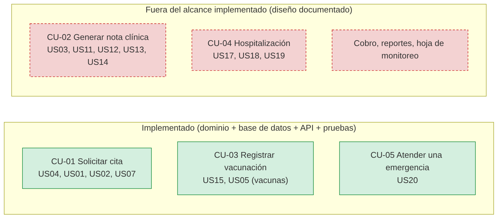

# Alcance implementado

## Resumen

| Caso de uso | Historias | Estado | Evidencia |
|---|---|---|---|
| CU-01 Solicitar cita | US04, US01, US02, US07 | **Implementado** (dominio, base de datos, API, pruebas) | 120 casos y 20 transiciones del paquete, 33+ pruebas de API |
| CU-03 Registrar vacunación | US15, US05 (vacunas) | **Implementado** | `test_servicios_vacunacion.py`, `test_seguimiento_vacunacion.py` |
| CU-05 Atender una emergencia | US20 | **Implementado** | 20 escenarios HTTP (`tests/api_emergencias.py`) |
| CU-02 Generar nota clínica (expediente) | US03, US11–US14 | **Fuera del alcance implementado** | Solo diseño |
| CU-04 Registrar hospitalización | US17–US19 | **Fuera del alcance implementado** | Solo diseño |

## Por qué CU-02 y CU-04 quedan fuera

El proyecto priorizó profundidad sobre amplitud: tres casos de uso completos (reglas de dominio, máquina de estados, Specifications, eventos, persistencia, API, pruebas, CI y despliegue) en lugar de cinco superficiales (ADR-09). El diseño de CU-02 y CU-04 se conserva en los diagramas, que los marcan en rojo como «NO IMPLEMENTADO», y en el informe de arquitectura de la Unidad 3. Retomarlos exige: agregado `ExpedienteClinico` con `NotaClinica` (la invariante R-03 protege las notas del veterinario), agregado `Hospitalizacion`, sus repositorios y sus eventos (`NotaClinicaRegistrada`, `HospitalizacionIniciada`).

## Diagramas y su relación con el código

Los diagramas de la Unidad 3 (mapa de dominio, clases y secuencias) se conservan y se marcan; los nombres del diseño están en inglés/CamelCase y el código usa equivalentes en español:

| Diseño (Unidad 3) | Código |
|---|---|
| `CitasApplicationService` | `application/servicios.py::ServicioDeCitas` |
| `VacunacionApplicationService` | `application/servicios_vacunacion.py::ServicioDeVacunacion` |
| `EmergenciasApplicationService` | `application/servicios_emergencias.py::ServicioDeEmergencias` |
| `UnitOfWork` / `UnitOfWorkImpl` | `application/puertos.py::UnidadDeTrabajo` / `infrastructure/repositorios_sql.py::UnidadDeTrabajoSql` |
| `ControlDeAcceso` | `application/control_de_acceso.py` |
| `ServicioDeProgramacionDeCitas` | `domain/ciclo_de_vida.py` + `domain/disponibilidad.py` |
| `ServicioDeSeguimientoDeVacunacion` | `domain/seguimiento_vacunacion.py` |
| `NotificadorDeVeterinario` | `application/puertos.py` / `infrastructure/notificador.py::BandejaDeAvisos` |

Diagramas nuevos (fuente Mermaid en `architecture/diagrams/*.mmd`): arquitectura por capas, despliegue, máquinas de estado de Cita y Emergencia, secuencia de CU-05, modelo entidad-relación y Specifications.
