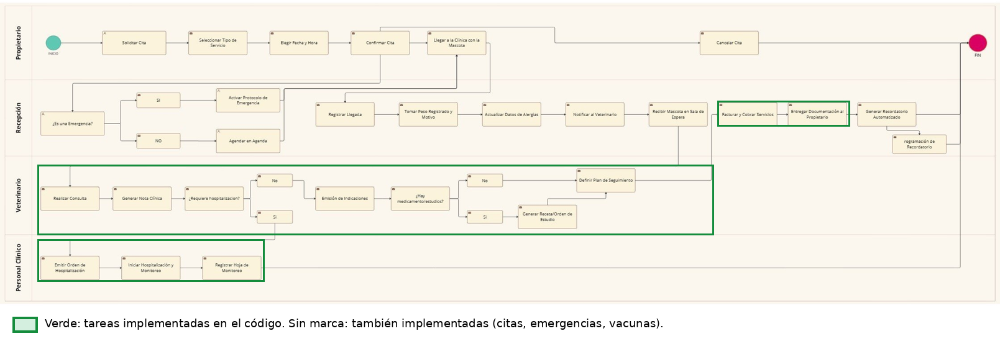

# Procesos de negocio (BPMN)

Proceso de atención de VetCare 24 con cuatro carriles: Propietario, Recepción, Veterinario y Personal clínico (Módulo Netacad 2).

La versión marcada señala en verde las tareas implementadas en el código: los carriles de Veterinario y Personal clínico (consulta, nota clínica, indicaciones, receta u orden de estudio, hospitalización con hoja de monitoreo) y, en Recepción, el cobro y la entrega de documentación. Las demás tareas (solicitar, confirmar y cancelar la cita, protocolo de emergencia, notificación al veterinario y recordatorios de vacunas) también están implementadas; el diagrama muestra de forma simplificada el seguimiento de vacunas.

Original sin marcas: [`bpmn_original.png`](bpmn_original.png).
